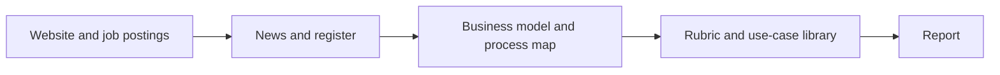

# AI Use Case Identifier

An autonomous research agent for AI consulting with small and mid-sized companies. Give it a company name and website. It reads public sources, works out how the company runs and earns money, judges every process step against established AI frameworks, matches the best steps against a library of AI use cases already running elsewhere, and writes a brief with three use cases and the questions for the first meeting.

**Report user:** an AI consultant preparing a first conversation with an SME. Later, the same brief can be offered to companies in exchange for their contact details (see [gtm_future_sprints.md](gtm_future_sprints.md)).

## What a report contains

1. **The company:** business model, unit economics, and the current process map. Every statement is marked *documented* with a link, or *assumption* (typical for companies of this kind).
2. **Where AI fits:** the overall approach for this company, and the steps to leave alone for now.
3. **Three use cases:** the process step, what changes in the work, which unit-economics lever it moves, the framework reasoning, the frontier pattern it is adapted from, and the prerequisites.
4. **Questions for the first meeting:** assumptions to test, "do you have this?" questions, and what to learn to decide between the use cases, plus the numbers to ask for and the gaps in the public research.
5. **Sources.**

Sample reports are in [samples/](samples/).

## How it works



Five LangGraph nodes share one typed state. Details are in [docs/architecture.md](docs/architecture.md). The reasons for LangGraph over n8n are in [stack_decision.md](stack_decision.md).

**Grounding** has two layers:

- [corpus/frameworks/rubric.md](corpus/frameworks/rubric.md): how to think about AI in a company, written in our own words from HBR, OpenAI, appliedAI, MIT Sloan, and Taylor Radey, with links. No articles are copied into the repo.
- [corpus/use_cases/](corpus/use_cases/): use-case cards from n8n, Anthropic, OpenAI, Google Cloud, and the KI-Landkarte, embedded in Pinecone (RAG).

## Setup

Requires Python 3.12 (3.11 or later should work).

```bash
python -m venv .venv
.venv\Scripts\activate          # Windows
# source .venv/bin/activate     # macOS / Linux
pip install -r requirements.txt
copy .env.example .env          # then fill in the keys
```

Keys in `.env`:

| Key | Where to get it |
|---|---|
| `OPENAI_API_KEY` | platform.openai.com |
| `TAVILY_API_KEY` | tavily.com (free tier) |
| `PINECONE_API_KEY` | app.pinecone.io (free starter tier) |

Build the use-case index once, and again after adding or changing cards:

```bash
python -m app.library
```

## Run

```bash
python -m app.run --company "Riese & Müller" --url "https://www.r-m.de"
```

The report is written to `outputs/<company>/report.md`, the full state to `state.json`. Optional `--contact-name`, `--contact-email`, and `--city` are stored in `lead.json` only.

A run takes about one minute and costs a few cents: `gpt-4o-mini` for research and modeling, `gpt-5.4-mini` (or your `REASONING_MODEL`) for use-case selection, a few embedding queries, and two to three Tavily searches.

## Adding use cases

Add a YAML file to `corpus/use_cases/`, one card per concrete case, written in your own words:

```yaml
id: n8n-invoice-datev
title: Supplier invoices from email into DATEV
source_name: n8n workflow template
source_url: https://n8n.io/workflows/...
verified: true
pattern: What the process looked like before.
ai_does: What the AI does in that process.
process_types: [finance, accounts payable]
needs: [email inbox, DATEV, purchase orders in a system]
sme_fit: When this fits an SME.
money_lever: unit_cost          # volume | price | unit_cost | risk
typical_effect: The result, with a number if the source gives one.
approach: quick win             # quick win | redesign then automate | strategic bet
blueprint_url: https://...      # optional: reference architecture
```

Then run `python -m app.library` again.

## Limits

- Public data only. Reviews and personal data are not collected.
- Figures from data aggregators are marked as estimates. Register portals often hide figures behind paywalls.
- Websites that render content only with JavaScript, or block bots, yield little text. The report then says so.
- The brief is a hypothesis for a conversation, not a validated analysis and not legal advice.

## Repository

```
app/
  run.py            CLI entry point
  graph.py          LangGraph wiring
  state.py          Pydantic state and output schemas
  library.py        Use-case cards and the Pinecone index
  nodes/            research, model, match, report
  tools/            website fetch, Tavily search
  templates/        report template
corpus/
  frameworks/       rubric.md
  use_cases/        YAML cards
docs/architecture.md
samples/            committed example reports
stack_decision.md
gtm_future_sprints.md
```
