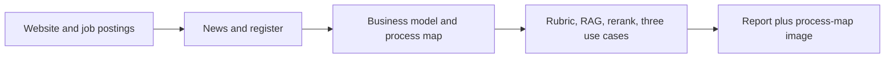

# AI Use Case Identifier

An autonomous research agent for AI consulting with small and mid-sized companies. Give it a company name and website. It reads public sources, works out how the company runs and earns money, judges every process step against established AI frameworks, matches the best steps against a library of AI use cases already running elsewhere, and writes a brief with three use cases and the questions for the first meeting.

**Report user:** an AI consultant using the full brief as a thinking aid for first conversations. Later, a lighter public report can work as a web lead magnet (three use cases for email and phone) — see [gtm_future_sprints.md](gtm_future_sprints.md).

## What a report contains

1. **The company:** business model, unit economics, and a process-map image from public research. Claims are marked *documented* or *assumption*.
2. **Where AI fits:** overall approach for this company, and steps to leave alone for now.
3. **Three use cases:** process step, process change before AI, how work runs afterwards, money effect, reference pattern, and pilot.
4. **Redesign the work, then apply AI:** redesign-before-automation stance, Option A (substitute) vs Option B (augment), plus one speculative Option-B case.
5. **Questions for the first meeting:** how to approach the conversation, general discovery questions, use-case questions, and numbers to ask for.
6. **Sources.**

Sample reports are in [samples/](samples/) (`riese-mueller`, `koro`, `ankerstein`), each with a matching `*-process-map.png`.

## How it works



Five LangGraph nodes share one typed state. Details are in [docs/architecture.md](docs/architecture.md). The reasons for LangGraph over n8n are in [stack_decision.md](stack_decision.md).

**Grounding** has two layers:

- [corpus/frameworks/](corpus/frameworks/): `rubric.md` (how to judge AI opportunities), `process_redesign.md` (redesign before automation; augment vs substitute), `discovery.md` (what to learn in the first meeting). Written in our own words with source links; articles are not copied into the repo.
- [corpus/use_cases/](corpus/use_cases/): curated YAML cards (seed patterns + extensions), embedded in Pinecone (RAG). At match time the top retrieval hits are reranked by company fit (70%) and similarity (30%).

## Setup

Requires Python 3.12 (3.11 or later should work).

```bash
python -m venv .venv
.venv\Scripts\activate          # Windows
# source .venv/bin/activate     # macOS / Linux
pip install -r requirements.txt
copy .env.example .env          # then fill in the keys
```

Keys in `.env`:

| Key | Where to get it |
|---|---|
| `OPENAI_API_KEY` | platform.openai.com (research, modeling, matching) |
| `OPENAI_KEY2` | Separate OpenAI key with image-model access (process-map PNG only) |
| `TAVILY_API_KEY` | tavily.com (free tier) |
| `PINECONE_API_KEY` | app.pinecone.io (free starter tier) |

Optional: `MODEL`, `REASONING_MODEL`, `EMBEDDING_MODEL`, `IMAGE_MODEL`, `PINECONE_INDEX` — see [.env.example](.env.example). **Never commit `.env` or real keys.**

### Tools / APIs

| Tool | Role |
|---|---|
| OpenAI (chat + embeddings) | Research filtering, business model, rubric rating, use-case selection, company-fit rerank |
| OpenAI Image API (`OPENAI_KEY2`) | Process-map PNG illustration |
| Tavily | News, register/size, and job search |
| Pinecone | Vector index for the use-case library (RAG) |

Three core services for the autonomous path (OpenAI text, Tavily, Pinecone), plus a separate image key for the map.

Build the use-case index once, and again after adding or changing cards:

```bash
python -m app.library
```

## Run

```bash
python -m app.run --company "Riese & Müller" --url "https://www.r-m.de"
```

Writes `outputs/<company>/report.md`, `state.json`, and `process-map.png`. Optional `--contact-name`, `--contact-email`, and `--city` go to `lead.json` only.

A full run uses text models, embeddings, Tavily, Pinecone retrieval + company-fit rerank, and one Image API call via `OPENAI_KEY2` / `IMAGE_MODEL` (default `gpt-image-2`). If image generation fails, the report still completes with a note and without the PNG.

## Adding use cases

Add cards under `corpus/use_cases/` (own words, verified source links), then:

```bash
python -m app.library
```

## Demo

- **Live demo:** run the CLI (or open a saved sample if APIs are slow). Backup reports: [samples/riese-mueller.md](samples/riese-mueller.md), [samples/koro.md](samples/koro.md), [samples/ankerstein.md](samples/ankerstein.md).
- **Recording:** _add an unlisted Loom / YouTube / Drive link here before submission_ (must open without login).
- **Slides:** [presentation/project3_slides.pdf](presentation/project3_slides.pdf) (also `.pptx` in the same folder).

## Limits

- Public data only. Reviews and personal data are not collected.
- Figures from data aggregators are marked as estimates. Register portals often hide figures behind paywalls.
- Websites that render content only with JavaScript, or block bots, yield little text. The report then says so.
- The brief is a hypothesis for a conversation, not a validated analysis and not legal advice.

## Repository

```
app/
  run.py            CLI entry point
  graph.py          LangGraph wiring
  state.py          Pydantic state and output schemas
  library.py        Use-case cards and the Pinecone index
  process_map.py    Process-map image generation
  nodes/            research, model, match, report
  tools/            website fetch, Tavily search
  templates/        report template
corpus/
  frameworks/       rubric, process redesign, discovery
  use_cases/        YAML cards
docs/architecture.md
samples/            example reports and process-map PNGs
stack_decision.md
gtm_future_sprints.md
```
