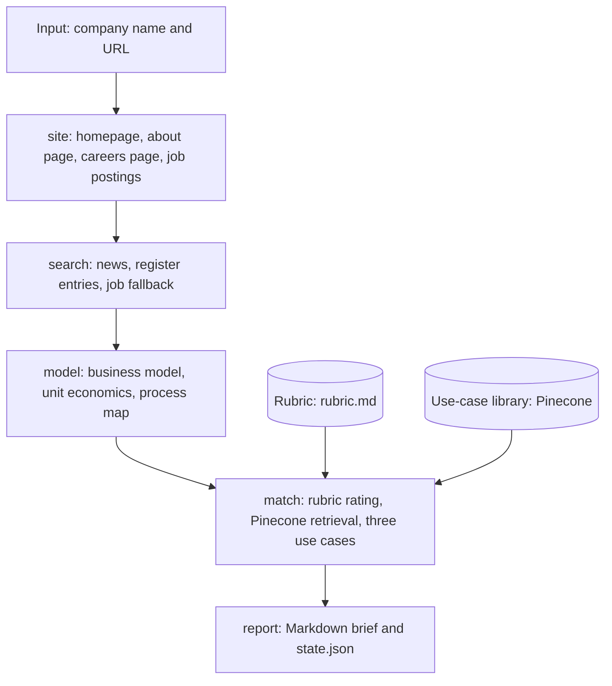

# Architecture

One linear LangGraph run. Every node reads and extends the same Pydantic `RunState`. No node can stop the run: failures become notes, and the notes become open questions in the report.

## Nodes

| Node | File | Tools | Output on the state |
|---|---|---|---|
| site | `app/nodes/research.py` | `httpx`, BeautifulSoup | `site_pages`, `job_postings` |
| search | `app/nodes/research.py` | Tavily | `news`, `register_hits`, fallback `job_postings` |
| model | `app/nodes/model.py` | OpenAI structured output | `model` (business model, unit economics, process map, open numbers) |
| match | `app/nodes/match.py` | OpenAI, Pinecone | `ratings`, `candidates`, `picks` |
| report | `app/nodes/report.py` | Jinja2 | `outputs/<company>/report.md`, `state.json` |

## Evidence

Every source gets an id (S1, S2, and so on) before the model sees it. The model cites ids only. Python replaces each id with its URL and downgrades anything marked "documented" without a valid id to "assumption". Figures from data aggregators are labeled as estimates.

## Grounding: two layers

- **How to think.** `corpus/frameworks/rubric.md` holds nine short sections written in our own words from public HBR, OpenAI, appliedAI, MIT Sloan, and Taylor Radey material, each with a check question and a link. It goes into the prompt whole on every run.
- **What others already do.** `corpus/use_cases/*.yaml` holds the use-case cards. `python -m app.library` embeds each card with OpenAI and upserts it to Pinecone. At run time, the five most promising process steps each retrieve the eight nearest cards; an LLM reranks them by company fit (70%) and similarity (30%) and keeps the top three. The model may only adapt a retrieved-and-reranked card, and code checks this.

## Tools

| Tool | Used for | Cost |
|---|---|---|
| OpenAI `gpt-4o-mini` | Business model, step rating, use-case selection | A few cents per report |
| OpenAI `text-embedding-3-small` | Card and query embeddings | Fractions of a cent |
| Tavily | News, register entries, job fallback | Free tier, 2 to 3 searches per report |
| Pinecone serverless | Use-case vector index | Free starter tier |
| `httpx`, BeautifulSoup | Reading the company website | Free |
