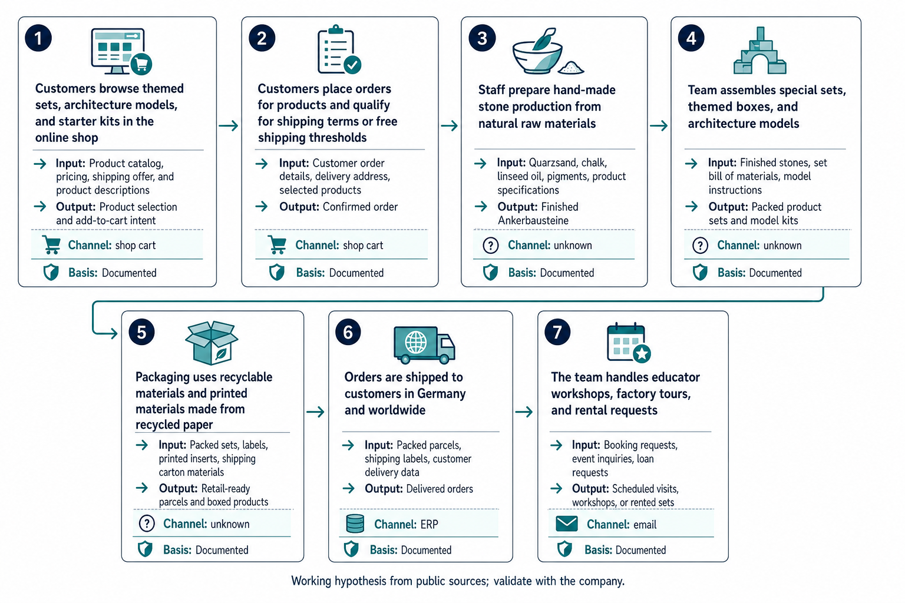
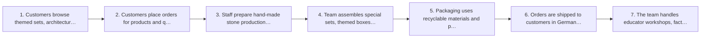

# AI Use Case Brief: Ankerstein

12 November 2026 · [https://anker-bausteine.de](https://anker-bausteine.de)

> Prepared from public sources before a first conversation. Statements marked *documented* link to their source. Statements marked *assumption* describe what companies of this kind usually do. They are hypotheses for the meeting, not facts about Ankerstein.

## 1. The company

**Ankerstein is a German manufacturer and online seller of traditional, sustainable construction and educational toys made from natural materials.**

### Business model

- Customers pay for physical Ankerbausteine products: starter sets, themed sets, architecture models, expansion sets, and special editions. *([documented](https://anker-bausteine.de))*
- Sales happen mainly through the company’s own website/shop, where products are listed with prices, availability, shipping terms, and direct checkout-style merchandising. *([documented](https://anker-bausteine.de))*
- The company also monetizes adjacent services such as workshops for educators, factory tours, and rental/loan of building blocks for events. *([documented](https://anker-bausteine.de/staunen/ueber-uns/))*
- The core market is Germany, with customers also described as worldwide; products and content target families, educators, architects, model builders, and enthusiasts. *([documented](https://anker-bausteine.de/staunen/ueber-uns/))*

### Unit economics

- The earning unit is a physical set or box of Ankerbausteine; margin is driven by premium product price, direct-to-consumer mix, and the ability to sell themed or licensed special editions at higher prices. *([documented](https://anker-bausteine.de))*
- Cost is driven by hand production from natural raw materials, precision manufacturing, and packaging/shipping, which the company emphasizes as part of its value proposition. *([documented](https://anker-bausteine.de/staunen/ueber-uns/))*
- Unit economics likely benefit from durable, reusable products and bundles/sets that increase basket value, while shipping cost is offset through free-shipping thresholds for German orders above 100 €. *([documented](https://anker-bausteine.de))*
- The company’s margin also depends on low-volume, high-variety production typical of a niche toy manufacturer. *(assumption)*

### Preliminary process overview

Working hypothesis derived from public sources; to be validated with the company.

| # | Step | What moves | Channel | Basis |
|---|------|------------|---------|-------|
| 1 | Customers browse themed sets, architecture models, and starter kits in the online shop | in: Product catalog, pricing, shipping offer, and product descriptions → out: Product selection and add-to-cart intent | shop cart | *([documented](https://anker-bausteine.de))* |
| 2 | Customers place orders for products and qualify for shipping terms or free shipping thresholds | in: Customer order details, delivery address, selected products → out: Confirmed order | shop cart | *([documented](https://anker-bausteine.de))* |
| 3 | Staff prepare hand-made stone production from natural raw materials | in: Quarzsand, chalk, linseed oil, pigments, product specifications → out: Finished Ankerbausteine | unknown | *([documented](https://anker-bausteine.de/staunen/ueber-uns/))* |
| 4 | Team assembles special sets, themed boxes, and architecture models | in: Finished stones, set bill of materials, model instructions → out: Packed product sets and model kits | unknown | *([documented](https://anker-bausteine.de/staunen/ueber-uns/))* |
| 5 | Packaging uses recyclable materials and printed materials made from recycled paper | in: Packed sets, labels, printed inserts, shipping carton materials → out: Retail-ready parcels and boxed products | unknown | *([documented](https://anker-bausteine.de/staunen/ueber-uns/))* |
| 6 | Orders are shipped to customers in Germany and worldwide | in: Packed parcels, shipping labels, customer delivery data → out: Delivered orders | ERP | *([documented](https://anker-bausteine.de))* |
| 7 | The team handles educator workshops, factory tours, and rental requests | in: Booking requests, event inquiries, loan requests → out: Scheduled visits, workshops, or rented sets | email | *([documented](https://anker-bausteine.de/staunen/ueber-uns/))* |

### Where AI fits in this business

Ankerstein should use AI first where the company already has explicit data and repetitive office work around its direct-to-consumer shop, not in the handmade production core. Because margins are shaped by premium set price, small-batch production, and shipping/fulfilment efficiency, the best near-term gains come from reducing handling time in order processing, lowering admin time around customer service, and speeding up content work that supports online sales. The business is small enough that a few hours saved per day can matter, but the company also needs to protect quality and brand trust, so humans should still approve exceptions and customer-facing output. The move to a new building is a good moment to standardize workflows and data fields before automating them. I would avoid big strategic AI bets in the workshop and manufacturing core for now, and focus on low-risk, visible improvements in the online shop and service operations.

**Leave alone for now**

- Staff prepare hand-made stone production from natural raw materials — high error cost and tacit craft knowledge; automating it would damage quality and is not a fit for AI now.
- Team assembles special sets, themed boxes, and architecture models — this is skilled, tactile work with high error cost; AI should not be used to replace the assembly process.
- The team handles educator workshops, factory tours, and rental requests — this is relationship-heavy, low-volume, and judgment-based; AI can help draft replies later, but it should not be automated now.

## 2. Three use cases

### 1. Draft FAQ replies for order, shipping, and product questions

**Process step:** Customers place orders for products and qualify for shipping terms or free shipping thresholds · **Approach:** quick win · **Lever:** lower cost per unit · **Human role:** Quality control (AI produces, a person verifies)

**Change the process first.** Create a short approved FAQ and route all incoming order and shipping questions to one shared mailbox label so the team no longer answers from scattered inboxes. Define which questions can be answered from approved content and which must go to a person immediately.

**How the work runs afterwards.** When a customer email asks about shipping cost, delivery area, payment, or product availability, the AI finds the best approved answer and drafts a reply. A named staff member checks the draft, edits exceptions, and sends it. Anything outside the FAQ or involving order changes goes straight to the human reviewer.

**Money effect.** At ~10 customer emails/day (assumption) and ~4 minutes to draft each reply today (assumption), this frees about 40 minutes/day, or roughly 3.5 hours/week, while also reducing repetitive support work.

**Why it fits.** This step has explicit knowledge and low error cost, so AI can draft the answer while a person verifies it. It also fits a quick win because the company already has a mail-based workflow and the work is repetitive. The value is unit cost reduction rather than strategic redesign.

**Reference pattern.** Adapted from "Draft FAQ answers from approved support content" ([n8n](https://n8n.io/workflows/4279-automated-email-sorting-and-drafting-for-customer-support-with-ai/)); workflow template.

**Source evidence.** Template categorizes support email and saves FAQ responses as Gmail drafts for review. Publisher-reported; this does not establish the same outcome for this company.

**What has to be in place**

- A current approved FAQ for shipping, payment, returns, and product basics
- One shared customer-service mailbox or label for incoming questions
- A named reviewer who owns approval of outbound replies
- GDPR-compliant handling of customer email data

**Pilot.** Baseline: current average handling time per customer email and current correction rate. Success measure: handling time and factual accuracy from the card's pilot metrics. Owner: customer service lead. Scale when drafts are accurate on the FAQ topics and the reviewer time stays lower than the current drafting time.

### 2. Turn emailed orders into clean ERP-ready order entries

**Process step:** Orders are shipped to customers in Germany and worldwide · **Approach:** redesign then automate · **Lever:** lower cost per unit · **Human role:** Quality control (AI produces, a person verifies)

**Change the process first.** Standardize the order intake form and create a single exception rule for incomplete address, shipping, or product data before orders enter ERP. Remove manual re-typing from the normal path and make one person responsible for exception handling.

**How the work runs afterwards.** When an order comes in by email or with mixed attachments, the AI extracts customer details, items, and shipping data into a draft order. The process owner checks price, product code, and shipping exceptions, then approves the ERP action. Clean orders flow through faster; only edge cases need manual correction.

**Money effect.** Danfoss-like cases save about five minutes per order in published references, but for Ankerstein this is an assumption. If Ankerstein handles ~8 manual exception-heavy orders/day (assumption), and this saves ~5 minutes each (assumption), that is about 40 minutes/day saved, or roughly 3 hours/week, plus fewer re-entry errors.

**Why it fits.** This is a concrete task with explicit data, and the error cost is still low enough for AI-assisted drafting but high enough that a human should approve consequential actions. It also needs process redesign first, because the current step is essentially re-typing and exception chasing. The main lever is lower unit cost in order handling.

**Reference pattern.** Adapted from "Interpret emailed orders and quotation requests" ([Google Cloud / Danfoss](https://cloud.google.com/customers/danfoss?hl=zh-TW)); customer case study.

**Source evidence.** Danfoss reports 50% less processing time and about five minutes saved per order. Publisher-reported; this does not establish the same outcome for this company.

**What has to be in place**

- A current product catalog with SKU, pricing, and shipping rules
- An ERP or order-entry connector that can receive draft orders
- A named exception owner for price, product, and shipping anomalies
- GDPR-compliant handling of customer order data

**Pilot.** Baseline: current minutes per order and erroneous order entries. Success measure: minutes per order and erroneous order entries from the card's pilot metrics. Owner: operations or order-processing lead. Scale when the draft-to-ERP handoff is reliable and error rates stay below the current manual baseline.

### 3. Draft product listing copy from verified product attributes

**Process step:** Customers browse themed sets, architecture models, and starter kits in the online shop · **Approach:** quick win · **Lever:** more units sold · **Human role:** Creative catalyst (AI proposes, a person chooses)

**Change the process first.** Create a structured product-attribute sheet for each new or updated set so the writing task starts from approved facts instead of free-form notes. Define a review rule that any claim about materials, age suitability, dimensions, or heritage must be checked before publishing.

**How the work runs afterwards.** When a new set, special edition, or translated listing is needed, the AI turns the verified product sheet into draft shop copy and alternate channel text. A human chooses the best wording, checks brand tone and factual accuracy, and publishes the final version. This speeds first drafts without changing the final approval step.

**Money effect.** If one new or updated product page takes ~30 minutes to draft and localize today (assumption), and AI cuts that to ~10 minutes with human review (assumption), each page saves ~20 minutes. At ~6 listings/month needing updates or new copy (assumption), that is about 2 hours/month saved.

**Why it fits.** The step is explicit and repetitive, but the wording still needs brand judgment, so AI should propose and a person should choose. It is a quick win because the company already sells through its own shop and needs listing work whenever sets or special editions change. The gain is faster content throughput that supports sales volume.

**Reference pattern.** Adapted from "Draft and localize product listings" ([n8n](https://n8n.io/workflows/13673-generate-e-commerce-product-descriptions-from-a-form-with-google-gemini/)); workflow template.

**Source evidence.** Template generates listings from product form data and optionally translates them. Publisher-reported; this does not establish the same outcome for this company.

**What has to be in place**

- A structured product attribute sheet for each SKU or set
- A brand/style guide for product descriptions
- A reviewer who approves factual claims before publishing
- If translations touch personal or customer data, GDPR review; if any AI-assisted marketing claims are used, check applicable EU consumer and AI rules

**Pilot.** Baseline: current preparation time per listing and current correction rate. Success measure: approved listings per hour and correction rate from the card's pilot metrics. Owner: e-commerce/content lead. Scale when approved listings increase without a rise in factual corrections or brand edits.

## 3. Questions for the first meeting

Ordered by: without an answer, there is no pilot.

- Who owns customer-service replies and order-processing exceptions today, and who would be the named reviewer for AI drafts in each process?
- What are the current volumes for customer emails, manual order exceptions, and new or revised product listings per week or month?
- How many minutes does the team spend today on one customer reply, one manual order entry, and one listing draft, including review time?
- What systems hold the product catalog, order data, and shipping rules, and can we connect them or export them in a structured way?
- Which questions are safe to answer from approved content, and which topics must always go to a human because they involve pricing exceptions, shipping exceptions, or customer complaints?
- For each of the three processes, what is the current error rate or rework rate that we should use as the baseline for the pilot?

### Numbers to ask for

- Annual revenue
- Average order value
- Share of direct online sales versus services
- Production volume per year
- Gross margin or unit cost per set
- Customer and geographic revenue split beyond Germany/worldwide
- ~10 customer emails/day (assumption in money_effect 1)
- ~4 minutes to draft each customer reply today (assumption in money_effect 1)
- ~8 manual exception-heavy orders/day (assumption in money_effect 2)
- ~5 minutes saved per order (assumption in money_effect 2, based on published reference but unverified for Ankerstein)
- ~30 minutes to draft and localize one product listing today (assumption in money_effect 3)
- ~10 minutes with AI plus review per product listing (assumption in money_effect 3)
- ~6 listings/month needing updates or new copy (assumption in money_effect 3)
- Current volume of customer emails
- Current volume of manual order exceptions
- Current volume of new or revised product listings
- Current minutes per customer reply including review
- Current minutes per manual order entry including review
- Current minutes per listing draft including review
- Current error rate for customer replies
- Current error rate for order entries
- Current correction rate for product listings

### Gaps in the public research

- No recent news found.

## 4. How these use cases were chosen

Every process step was rated against a rubric drawn from public frameworks: the money lever it touches, error cost and type of knowledge (HBR), whether the task is repetitive, a bottleneck, or ambiguous (OpenAI, Taylor Radey), the full cost including human review (MIT Sloan), and feasibility in data, systems, and know-how (appliedAI). The most promising steps were matched against a curated library of customer cases, documented solutions, and workflow templates, and three were adapted to this company.

- [APQC, How Can Organizations Identify And Prioritize Valuable AI Use Cases?](https://www.apqc.org/How-Can-Organizations-Identify-And-Prioritize-Valuable-AI-Use-Cases)
- [AWS, Taxonomy of agentic primitives in Amazon Quick (2026)](https://aws.amazon.com/blogs/machine-learning/taxonomy-of-agentic-primitives-in-amazon-quick/)
- [Anand and Wu, The Gen AI Playbook for Organizations, HBR (2025)](https://hbr.org/2025/11/the-gen-ai-playbook-for-organizations)
- [OpenAI, Identifying and scaling AI use cases](https://openai.com/business/learn/identifying-and-scaling-ai-use-cases/)
- [appliedAI, How to find and prioritize AI use cases (2020)](https://www.appliedai.de/uploads/files/Whitepapers/appliedAI-Whitepaper-Applying-AI-How-to-find-and-prioritize-AI-use-cases-2020-EN.pdf)
- [MIT Sloan, How to find the right business use cases for generative AI (2025)](https://mitsloan.mit.edu/ideas-made-to-matter/how-to-find-right-business-use-cases-generative-ai)
- [Taylor Radey, Finding AI use cases: one helpful framework to try (2025)](https://www.taylorradey.com/post/finding-ai-use-cases-framework)

## 5. Sources

- [Ankerstein Bausteine | Nachhaltige Bau- und Lernspielzeuge made in Germany | Ankerstein GmbH](https://anker-bausteine.de)
- [Ankerstein GmbH – Traditionelles Spielzeug aus Rudolstadt seit 1880 | Ankerstein GmbH](https://anker-bausteine.de/staunen/ueber-uns/)
- [Zeiss-Planetarium Jena aus Ankerbausteinen | Jubiläumsedition | Ankerstein](https://anker-bausteine.de/zeiss-planetarium-jena-anker-sonderbaukasten/0058952)
- Company record: [Spielwarenmesse - Spirit of Play | Building the future: with Ankersteinen for 140 years](https://www.spielwarenmesse.de/en/mag/toy-lab/building-the-future-with-ankersteinen-for-140-years)
