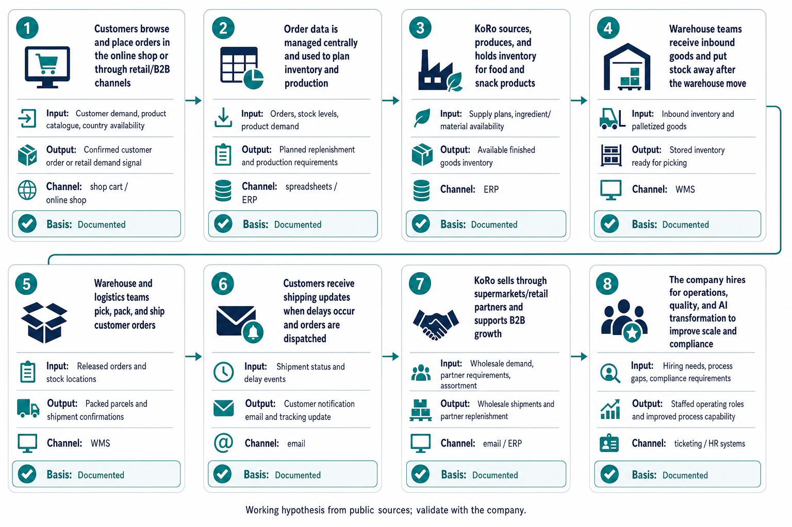

# AI Use Case Brief: KoRo

12 November 2026 · [https://www.korodrogerie.de](https://www.korodrogerie.de)

> Prepared from public sources before a first conversation. Statements marked *documented* link to their source. Statements marked *assumption* describe what companies of this kind usually do. They are hypotheses for the meeting, not facts about KoRo.

## 1. The company

**Consumer-facing natural foods and household essentials retailer, selling mainly via its own online shop and also through supermarkets/retail channels.**

### Business model

- Customers pay KoRo for food, snacks, superfoods, and everyday consumer goods sold in the online shop and, according to the company, also available in supermarkets nearby. *([documented](https://www.korodrogerie.de))*
- KoRo sells directly to consumers across Europe and is also expanding into B2B, so revenue comes from both D2C and business customers. *([documented](https://www.microsoft.com/en/customers/story/27081-koro-handels-dynamics-365-business-central))*
- The company operates in 14 European countries with food supply from its Berlin-based organization. *([documented](https://www.korodrogerie.de/career))*
- KoRo’s legal purpose is the trade of drugstore items and everyday consumer goods, indicating retail/trading as the core monetization model. *([documented](https://www.northdata.de/KoRo%20Handels%20GmbH,%20Berlin/Amtsgericht%20Charlottenburg%20(Berlin)%20HRB%20156598%20B))*

### Unit economics

- The earning unit is the individual order, with margin driven by basket value, product mix, and fulfillment efficiency in large-pack ecommerce. *(assumption)*
- Gross margin is likely sensitive to sourcing cost, inventory handling, and shipping cost per order, especially because KoRo emphasizes large packs and logistics efficiency. *(assumption)*
- Order throughput matters: KoRo says it can now process more orders after moving to a larger warehouse, showing fulfillment capacity is a key margin lever. *([documented](https://www.korodrogerie.de/b/lieferverzoegerungen-nach-lagerumzug))*

### Preliminary process overview

Working hypothesis from public sources; validate with the company.

- **1. Customers browse and place orders in the online shop or through retail/B2B channels** · shop cart / online shop · *([documented](https://www.korodrogerie.de))*
- **2. Order data is managed centrally and used to plan inventory and production** · spreadsheets / ERP · *([documented](https://www.microsoft.com/en/customers/story/27081-koro-handels-dynamics-365-business-central))*
- **3. KoRo sources, produces, and holds inventory for food and snack products** · ERP · *([documented](https://www.microsoft.com/en/customers/story/27081-koro-handels-dynamics-365-business-central))*
- **4. Warehouse teams receive inbound goods and put stock away after the warehouse move** · WMS · *([documented](https://www.korodrogerie.de/b/lieferverzoegerungen-nach-lagerumzug))*
- **5. Warehouse and logistics teams pick, pack, and ship customer orders** · WMS · *([documented](https://www.korodrogerie.de/b/lieferverzoegerungen-nach-lagerumzug))*
- **6. Customers receive shipping updates when delays occur and orders are dispatched** · email · *([documented](https://www.korodrogerie.de/b/lieferverzoegerungen-nach-lagerumzug))*
- **7. KoRo sells through supermarkets/retail partners and supports B2B growth** · email / ERP · *([documented](https://www.korodrogerie.de))*
- **8. The company hires for operations, quality, and AI transformation to improve scale and compliance** · ticketing / HR systems · *([documented](https://www.remotely.de/firma/koro-handels-gmbh))*

### Where AI fits in this business

KoRo should use AI first where it can reduce operating cost per order, shorten repetitive coordination work, and improve scale after the warehouse move, while keeping humans on high-risk inventory and commercial decisions. The company’s core economics depend on order throughput, fulfillment efficiency, and avoiding waste or stock errors across multiple countries and channels. That makes process redesign more important than isolated automation: KoRo should standardize inputs, define owners, and then let AI draft, classify, or optimize within those rules. In the near term, the best value is in warehouse execution and master-data cleanup, because those are close to the core margin levers and have proven patterns. More strategic forecasting work can follow once the underlying data is cleaner and the operating baseline is stable.

**Leave alone for now**

- Customers receive shipping updates when delays occur and orders are dispatched — low direct economic leverage, and KoRo already uses this as a communication step rather than a margin lever.
- The company hires for operations, quality, and AI transformation to improve scale and compliance — high judgment and tacit knowledge; not a good first automation target.
- Customers browse and place orders in the online shop or through retail/B2B channels — already well suited to standard ecommerce automation; the stronger immediate opportunities are downstream in operations and data quality.

## 2. Three use cases

### 1. Clean inventory and master-data exports before planning

**Process step:** Order data is managed centrally and used to plan inventory and production · **Approach:** quick win · **Lever:** lower cost per unit · **Human role:** Quality control (AI produces, a person verifies)

**Change the process first.** Define one owner for planning exports, remove duplicate spreadsheet copies, and standardize the field names and merge rules before AI touches the data. Then let AI normalize formats, flag duplicates, and produce a change log for review.

**How the work runs afterwards.** Each day or planning cycle, the export lands in one approved location. AI cleans dates, categories, and duplicates, then a planner validates exceptions and signs off the final dataset before it feeds inventory and production planning.

**Money effect.** At roughly 20–40 recurring exports per week (assumption) and about 15 minutes of manual cleanup per export (assumption), this frees about 5–10 hours/week and reduces rework in planning.

**Reference.** Adapted from "Clean inconsistent spreadsheet and master-data exports" ([OpenAI / ChatGPT use cases](https://learn.chatgpt.com/use-cases/clean-messy-data)); workflow guide.

**Pilot.** Baseline the current weekly cleanup hours, incorrect merges, and unresolved records; the planning operations owner is accountable; scale when cleanup time falls materially and the validated dataset is accepted for planning with no material increase in bad merges.

### 2. Reduce warehouse travel after the move

**Process step:** Warehouse teams receive inbound goods and put stock away after the warehouse move · **Approach:** redesign then automate · **Lever:** lower cost per unit · **Human role:** No regrets (AI runs it)

**Change the process first.** Re-map the put-away process around the new warehouse layout, remove unnecessary walking paths and ad hoc placement rules, and define fixed storage zones before using AI. Then let AI analyze movement patterns and propose a better layout and put-away sequence.

**How the work runs afterwards.** After each inbound wave, movement and location data are captured automatically. AI proposes better storage assignments and route changes; warehouse leads approve the layout or routing changes and supervisors implement them on the floor.

**Money effect.** If the move created even 30–60 minutes of extra walking per shift for 2–3 shifts/day (assumption), a better layout could save about 1.5–3 labor hours/day, or roughly 500–1,000 hours/year.

**Reference.** Adapted from "Improve picking routes and warehouse layout" ([Plattform Lernende Systeme / META-Regalbau](https://www.plattform-lernende-systeme.de/booklet-include-elemente.html)); customer case study.

**Pilot.** Record current travel time per pick and throughput before changes; the warehouse operations owner is accountable; scale when travel time falls and throughput improves without raising mis-picks or put-away errors.

### 3. Draft and localize product listings for new SKUs

**Process step:** Customers browse and place orders in the online shop or through retail/B2B channels · **Approach:** quick win · **Lever:** more units sold · **Human role:** Creative catalyst (AI proposes, a person chooses)

**Change the process first.** Standardize the product brief so every new SKU has the same minimum attributes, approved claims, and brand rules before drafting starts. Then let AI generate listing drafts and translations, while a product owner chooses the best version and checks factual and food-related claims.

**How the work runs afterwards.** When a new product brief is complete, AI creates listing copy and localized variants from verified attributes. A merchandiser or product owner reviews the options, rejects unsafe or noncompliant claims, and publishes the final version.

**Money effect.** If KoRo launches or refreshes 10–20 listings per week (assumption) and each currently takes 45–60 minutes of drafting plus translation work (assumption), this could save about 8–20 hours/week and speed time-to-shelf.

**Reference.** Adapted from "Draft and localize product listings" ([n8n](https://n8n.io/workflows/13673-generate-e-commerce-product-descriptions-from-a-form-with-google-gemini/)); workflow template.

**Pilot.** Baseline current approved listings per hour and correction rate; the product content owner is accountable; scale when approved listings rise and correction rate stays below the agreed threshold.

## 3. Redesign the work, then apply AI

Do not automate the process as found — redesign it first. AI on yesterday’s workflow usually speeds up waste: retyping, handoffs, and approvals that should not exist. Break the work into tasks, cut or relocate what nobody needs, then decide what AI drafts or proposes and what a named person still owns. Ask which process to clean up first, and which human capabilities should get stronger afterward — not merely what can be automated.

Redesign pays when it moves unit economics, not when it saves a few clicks. Remove double entry and cycle time falls; standardize intake and errors fall; give specialists AI-prepared options and they spend time on judgment and customers. People stay accountable for money, legal, and customer outcomes; AI removes low-value motion around them. That is how AI becomes a complement instead of a faster broken process.

There are two ways to use AI in that redesign:

- **Option A — Automate / substitute.** AI copies what people already do and takes over those tasks. Machines become substitutes for labor. Output can get cheaper, but people become more replaceable and more of the upside goes to whoever owns the system.
- **Option B — Augment / complement.** AI enables people to do things they could not do before. Humans and machines are complements. Augmentation also tends to create new products, services, and tasks — not only cheaper versions of old ones.

This brief’s speculative redesign below is written as **Option B**.

**How we redesign with AI**

**Pattern we use in every brief**

| Step | Question | AI role | Human role |
|------|----------|---------|------------|
| 1. Purpose | What business outcome is this step for? | — | Name the lever (volume, price, unit cost, risk) |
| 2. Eliminate | What can disappear? | Flag duplicate/low-value steps from logs or samples | Cut re-entry, status theatre, unused approvals |
| 3. Standardize | One path in? | Enforce fields / classify intake | One exception owner |
| 4. Redesign flow | What is the new happy path? | Draft, retrieve, propose | Decide, commit money/customer/legal outcomes |
| 5. Pilot | Did a metric move? | Run on one queue/team | Baseline → compare → scale or stop |

**Business-value test.** Ship the redesign only if a named owner can point to a unit-economics lever and a baseline number to improve in the first meeting.

### Speculative case (Option B — augment / complement)

**AI-assisted assortment sensing for B2B expansion**

*Speculation for the meeting — not one of the three library-backed use cases above.*

**Today.** KoRo is expanding through B2B and supermarket channels, but assortment decisions and account conversations likely rely on fragmented sales signals, manual reviews, and commercial intuition across countries.

**Redesigned with AI.** Create a cross-channel signal desk where AI combines retailer sell-through, web demand, stock pressure, and regional seasonality into opportunity briefs. Commercial and category managers use those briefs to decide which packs, sizes, and localized assortments to push in each market, rather than only reacting to orders after the fact.

**New capability.** KoRo could proactively design retailer-specific assortment offers and identify regional demand gaps earlier, giving the team a new decision capability rather than just faster admin.

**Business value if true.** If the signal desk improves B2B close rate or assortment productivity by even a small amount, it could raise revenue per commercial head and reduce failed listings or slow-moving stock across countries.

## 4. Questions for the first meeting

### How to approach the conversation

As an AI consultant, start from the business, not from the tool: what the company wants to achieve, what blocks that, and which knowledge it can put to work — how it earns money, where cost and errors pile up, how work really runs, and where useful data and experience live (systems, files, or people’s heads). Only then ask where AI can connect information, create options, or take on steps — and which measurable result would prove the change was worth it.

### General questions

- What would “success in 12 months” look like in one sentence?
- Where do cost, delays, rework or complaints hurt most — and who owns that?
- Where does critical know-how live today, and how hard is it to find and trust?
- Who would own a first pilot, and which one metric would convince leadership?

### Use-case questions

Ordered by: without an answer, there is no pilot.

- Who owns the single source of truth for planning exports, and where does that file live today after the warehouse move?
- How many planning exports or master-data cleanup cycles do you run per week, and about how many minutes does each one take now?
- What are the current warehouse travel-time or put-away delays since the move, and which shifts or zones are the worst affected?
- How many inbound put-away workers and shifts are in scope, so we can turn travel-time changes into labor-hour savings?

### Numbers to ask for

- Revenue was not stated in the sources.
- Gross margin was not stated in the sources.
- Average order value was not stated in the sources.
- Fulfillment cost per order was not stated in the sources.
- Unit sales volumes by channel were not stated in the sources.
- 20–40 recurring exports per week

### Gaps in the public research

- Job postings come from web search, not from the company's own careers page.
- Use-case selection still breaks rules after one retry: 'Draft and localize product listings for new SKUs' sits on 'Customers browse and place orders in the online shop or through retail/B2B channels', which is also listed under leave_alone.

## 5. How these use cases were chosen

Every process step was rated against a rubric (money lever, HBR human role, opportunity type, full cost, feasibility, redesign-before-AI, augment vs substitute). The strongest steps were matched to a curated library via retrieval and company-fit reranking; three cards were adapted to this company.

- [APQC, How Can Organizations Identify And Prioritize Valuable AI Use Cases?](https://www.apqc.org/How-Can-Organizations-Identify-And-Prioritize-Valuable-AI-Use-Cases)
- [AWS, Taxonomy of agentic primitives in Amazon Quick (2026)](https://aws.amazon.com/blogs/machine-learning/taxonomy-of-agentic-primitives-in-amazon-quick/)
- [Anand and Wu, The Gen AI Playbook for Organizations, HBR (2025)](https://hbr.org/2025/11/the-gen-ai-playbook-for-organizations)
- [OpenAI, Identifying and scaling AI use cases](https://openai.com/business/learn/identifying-and-scaling-ai-use-cases/)
- [appliedAI, How to find and prioritize AI use cases (2020)](https://www.appliedai.de/uploads/files/Whitepapers/appliedAI-Whitepaper-Applying-AI-How-to-find-and-prioritize-AI-use-cases-2020-EN.pdf)
- [MIT Sloan, How to find the right business use cases for generative AI (2025)](https://mitsloan.mit.edu/ideas-made-to-matter/how-to-find-right-business-use-cases-generative-ai)
- [Taylor Radey, Finding AI use cases: one helpful framework to try (2025)](https://www.taylorradey.com/post/finding-ai-use-cases-framework)
- [MIT Sloan, Want AI-Driven Productivity? Redesign Work](https://sloanreview.mit.edu/article/want-ai-driven-productivity-redesign-work/)
- [MIT Sloan, Don’t Let Artificial Intelligence Supercharge Bad Processes](https://sloanreview.mit.edu/article/dont-let-artificial-intelligence-supercharge-bad-processes/)
- [HBR, The Secret to Successful AI-Driven Process Redesign (2025)](https://hbr.org/2025/01/the-secret-to-successful-ai-driven-process-redesign)
- [HBR, Stop Automating Old Processes. Design New Ones Instead. (2026)](https://hbr.org/2026/09/stop-automating-old-processes-design-new-ones-instead)
- [Randstad, Before you automate, AI-vate or agent-icate](https://www.randstadenterprise.com/insights/randstad-enterprise-insights/before-you-automate-ai-vate-or-agent-icate/)
- [Brynjolfsson, The Turing Trap, Stanford Digital Economy Lab (2022)](https://digitaleconomy.stanford.edu/news/the-turing-trap-the-promise-peril-of-human-like-artificial-intelligence/)

## 6. Sources

- [KoRo Online Shop: Top-Qualität in Großpackungen | KoRo](https://www.korodrogerie.de)
- [Lieferverzögerungen nach Lagerumzug: Alle Infos & Lieferzeiten](https://www.korodrogerie.de/b/lieferverzoegerungen-nach-lagerumzug)
- [KoRo Jobs & Karriere: Dein Platz im Team! | KoRo](https://www.korodrogerie.de/career)
- Job posting: [Remote & Homeoffice Jobs bei KoRo Handels GmbH | remotely.de](https://www.remotely.de/firma/koro-handels-gmbh)
- News: [KoRo Handels scales to 15,000 orders a day with Dynamics 365 Business Central | Microsoft Customer Stories](https://www.microsoft.com/en/customers/story/27081-koro-handels-dynamics-365-business-central)
- Company record: [KoRo Handels GmbH, Berlin, Amtsgericht Charlottenburg (Berlin) HRB 156598 B: Netzwerk, Wirtschaftsinfos](https://www.northdata.de/KoRo%20Handels%20GmbH,%20Berlin/Amtsgericht%20Charlottenburg%20(Berlin)%20HRB%20156598%20B)
