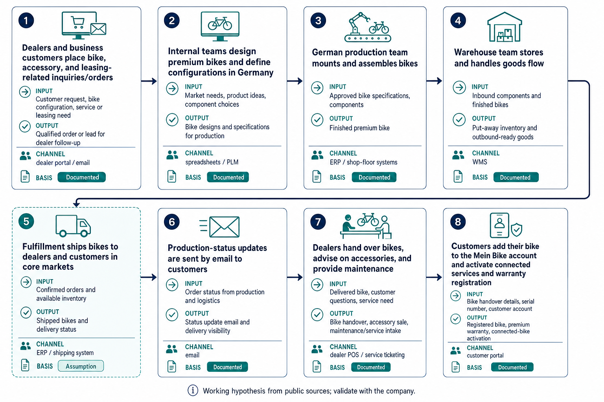

# AI Use Case Brief: Riese & Müller

12 November 2026 · [https://www.r-m.de](https://www.r-m.de)

> Prepared from public sources before a first conversation. Statements marked *documented* link to their source. Statements marked *assumption* describe what companies of this kind usually do. They are hypotheses for the meeting, not facts about Riese & Müller.

## 1. The company

**Premium e-bike and e-cargo bike manufacturer selling mainly through specialist dealers, with a connected-bike and business/fleet offering.**

### Business model

- Retail customers pay for premium e-bikes, cargo bikes, accessories, and related services through specialist bike dealers in local markets. *([documented](https://www.r-m.de/de/))*
- Employers and users pay for job-bike leasing through the company’s leasing offering, with service and mobility-garantie bundled in the proposition. *([documented](https://www.r-m.de/de/))*
- Business customers pay for premium bikes for fleet and sharing solutions via the Riese & Müller Business offering. *([documented](https://www.r-m.de/de/))*
- The company monetizes after-sales support and connected-bike services through dealer-based service, warranty, insurance, and RX Connect features. *([documented](https://www.r-m.de/de/ueber-uns/))*

### Unit economics

- The earning unit is a premium bicycle sold through the dealer network; margin is driven by product price, configuration richness, and premium positioning. *([documented](https://www.r-m.de/de/ueber-uns/))*
- Assembly in Germany and in-house design indicate margin pressure from manufacturing and component costs, offset by premium pricing. *([documented](https://www.r-m.de/de/ueber-uns/))*
- Dealer distribution matters for volume and reach; the company has about 1,400 dealers worldwide, and recently exited the US to concentrate on European core markets. *([documented](https://www.r-m.de/de/ueber-uns/))*
- Connected-bike and service features add value and may support attachment revenue, while warranty/insurance also shape the customer lifetime value. *([documented](https://www.r-m.de/de/ueber-uns/))*

### Preliminary process overview

Working hypothesis from public sources; validate with the company.

### Where AI fits in this business

Riese & Müller should use AI now to remove friction in dealer-facing operations and back-office coordination, not to touch core product design or assembly. The current strategic context—pulling back from the US and focusing on European core markets—makes speed, dealer responsiveness, and lower service cost more important than experimenting broadly. The best value is in structured, repeatable steps where explicit information already exists: dealer inquiries, warehouse reporting, and customer-facing status communication. Because premium positioning depends on accuracy and dealer trust, humans should still own exceptions and review on the steps that affect orders, customers, or service promises.

**Leave alone for now**

- Internal bikes design/configuration: high tacit know-how and high error cost; AI should not steer product decisions now.
- German production assembly: quality risk is too high for end-to-end automation, and the step is already execution-heavy.
- Dealer handover and maintenance advice: this is relationship-led, expert work where a person should stay in the lead.

## 2. Three use cases

### 1. Prioritize new dealer and fleet leads

**Process step:** Dealers and business customers place bike, accessory, and leasing-related inquiries/orders · **Approach:** quick win · **Lever:** more units sold · **Human role:** Creative catalyst (AI proposes, a person chooses)

**Change the process first.** Define one owner for inbound B2B leads, split true sales opportunities from service/admin requests, and standardize the fields that must be present before review. Then let AI score fit and draft a priority queue rather than trying to write outreach or quotes.

**How the work runs afterwards.** A new dealer or fleet inquiry triggers an AI review of the incoming record. AI classifies the request against the ideal customer profile and flags likely high-value leads; the sales owner confirms priority and assigns follow-up. Low-fit requests are routed to the right desk, but no automatic customer reply is sent.

**Money effect.** If Riese & Müller gets ~40 inbound dealer/fleet inquiries/day (assumption) and spends ~3 minutes triaging each (assumption), AI-assisted prioritization could save about 2 hours/day, while helping the team focus on more qualified opportunities in core European markets.

**Reference.** Adapted from "Prioritize incoming leads against a defined customer profile" ([Make / Lead Qualification Agent](https://we.make.com/public/shared-scenario/LEsubqrg0cA/lead-qualification-agent)); workflow template.

**Pilot.** Baseline: current daily qualification time and lead-to-meeting rate. Success measure: qualification minutes per lead and qualified meeting rate, with false rejections tracked. Owner: sales operations lead. Scale when the team can keep review quality stable while cutting triage time and improving meeting yield.

### 2. Interpret emailed orders and quotation requests

**Process step:** Fulfillment ships bikes to dealers and customers in core markets · **Approach:** redesign then automate · **Lever:** lower cost per unit · **Human role:** Quality control (AI produces, a person verifies)

**Change the process first.** Create one intake path for shipment-related requests and separate simple status checks from order-change exceptions. Standardize the required order fields and exception codes before AI extracts anything, then let AI draft the shipment/order action for review.

**How the work runs afterwards.** When a shipping-related email or order change arrives, AI extracts the order details, checks them against the approved catalog and available fulfillment data, and proposes the ERP action. A fulfillment or order-management person verifies exceptions and approves the final change before it is executed.

**Money effect.** If the fulfillment team handles ~60 shipment/order-change emails per day (assumption) and AI reduces handling by ~5 minutes each, that is about 5 hours saved per day. The bigger gain is fewer manual re-entries and fewer downstream shipping mistakes while the company concentrates on European core markets.

**Reference.** Adapted from "Interpret emailed orders and quotation requests" ([Google Cloud / Danfoss](https://cloud.google.com/customers/danfoss?hl=zh-TW)); customer case study.

**Pilot.** Baseline: minutes per request and error rate in order entry. Success measure: processing time per request and erroneous order entries. Owner: fulfillment operations manager. Scale when time drops without increasing order errors or missed deliveries.

### 3. Reduce warehouse travel and layout waste

**Process step:** Warehouse team stores and handles goods flow · **Approach:** redesign then automate · **Lever:** lower cost per unit · **Human role:** Quality control (AI produces, a person verifies)

**Change the process first.** Map the actual pick routes, storage locations, and delays first, then remove avoidable travel and re-slot fast movers before any optimization model is introduced. Standardize how movement data is captured so AI can propose layout and routing changes instead of guessing from inconsistent logs.

**How the work runs afterwards.** On a scheduled review cycle, AI analyzes movement patterns and proposes layout or route changes for the warehouse. The warehouse owner reviews the options, validates them with the team, and approves only the changes that do not disrupt service levels; the system then updates the preferred picking logic.

**Money effect.** If the warehouse makes ~300 picks/day (assumption) and layout/travel improvements cut just 20 seconds per pick (assumption), that saves about 1.7 labor hours/day. This matters because the company’s German production and warehouse costs sit inside a premium-margin model that is under pressure from manufacturing and component costs.

**Reference.** Adapted from "Improve picking routes and warehouse layout" ([Plattform Lernende Systeme / META-Regalbau](https://www.plattform-lernende-systeme.de/booklet-include-elemente.html)); customer case study.

**Pilot.** Baseline: travel time per pick and throughput. Success measure: reduced travel time per pick and stable or improved throughput. Owner: warehouse manager. Scale when the new layout improves pick efficiency without raising misses, damage, or stock errors.

## 3. Redesign the work, then apply AI

Do not automate the process as found — redesign it first. AI on yesterday’s workflow usually speeds up waste: retyping, handoffs, and approvals that should not exist. Break the work into tasks, cut or relocate what nobody needs, then decide what AI drafts or proposes and what a named person still owns. Ask which process to clean up first, and which human capabilities should get stronger afterward — not merely what can be automated.

Redesign pays when it moves unit economics, not when it saves a few clicks. Remove double entry and cycle time falls; standardize intake and errors fall; give specialists AI-prepared options and they spend time on judgment and customers. People stay accountable for money, legal, and customer outcomes; AI removes low-value motion around them. That is how AI becomes a complement instead of a faster broken process.

There are two ways to use AI in that redesign:

- **Option A — Automate / substitute.** AI copies what people already do and takes over those tasks. Machines become substitutes for labor. Output can get cheaper, but people become more replaceable and more of the upside goes to whoever owns the system.
- **Option B — Augment / complement.** AI enables people to do things they could not do before. Humans and machines are complements. Augmentation also tends to create new products, services, and tasks — not only cheaper versions of old ones.

This brief’s speculative redesign below is written as **Option B**.

**How we redesign with AI**

**Pattern we use in every brief**

| Step | Question | AI role | Human role |
|------|----------|---------|------------|
| 1. Purpose | What business outcome is this step for? | — | Name the lever (volume, price, unit cost, risk) |
| 2. Eliminate | What can disappear? | Flag duplicate/low-value steps from logs or samples | Cut re-entry, status theatre, unused approvals |
| 3. Standardize | One path in? | Enforce fields / classify intake | One exception owner |
| 4. Redesign flow | What is the new happy path? | Draft, retrieve, propose | Decide, commit money/customer/legal outcomes |
| 5. Pilot | Did a metric move? | Run on one queue/team | Baseline → compare → scale or stop |

**Business-value test.** Ship the redesign only if a named owner can point to a unit-economics lever and a baseline number to improve in the first meeting.

### Speculative case (Option B — augment / complement)

**Dealer cockpit for core-market demand signals**

*Speculation for the meeting — not one of the three library-backed use cases above.*

**Today.** Dealer teams and internal managers get fragmented signals from inbound requests, sales calls, stock status, and market feedback, so they mostly react to what is already obvious.

**Redesigned with AI.** Combine dealer inquiries, order patterns, service topics, and stock signals into an AI-generated weekly dealer cockpit. Humans review the patterns, choose actions, and use them to adjust assortment, stock allocation, and dealer support by region.

**New capability.** The company could spot regional demand shifts earlier and support dealers with better local decisions instead of only reacting after sales slow down or stockouts appear.

**Business value if true.** If better regional visibility improves dealer sell-through or reduces overstock by even a small amount across the European network, it can protect margin and improve working capital without changing the premium product itself.

## 4. Questions for the first meeting

### How to approach the conversation

As an AI consultant, start from the business, not from the tool: what the company wants to achieve, what blocks that, and which knowledge it can put to work — how it earns money, where cost and errors pile up, how work really runs, and where useful data and experience live (systems, files, or people’s heads). Only then ask where AI can connect information, create options, or take on steps — and which measurable result would prove the change was worth it.

### General questions

- What would “success in 12 months” look like in one sentence?
- Where do cost, delays, rework or complaints hurt most — and who owns that?
- Where does critical know-how live today, and how hard is it to find and trust?
- Who would own a first pilot, and which one metric would convince leadership?

### Use-case questions

Ordered by: without an answer, there is no pilot.

- Who owns lead qualification and can define the exact criteria for a good dealer or fleet opportunity, especially now that the company is focusing on Europe rather than the US?
- Do you already have current catalog, price, and availability data connected to order or fulfillment handling, or would that need to be cleaned up first?
- How many inbound dealer/fleet inquiries, shipping-related emails, and warehouse picks do you handle on an average day today?
- Roughly how many minutes does a person spend today triaging one lead, handling one shipment/order-change request, and processing one warehouse pick?

### Numbers to ask for

- Revenue, profit, and ASP by product line were not found in the sources.
- Dealer sales split by region after the US exit was not found in the sources.
- Order backlog and production capacity were not found in the sources.
- Warranty attach rate, insurance attach rate, and RX Connect conversion rate were not found in the sources.
- Inbound dealer/fleet inquiries per day
- Minutes spent triaging one lead

### Gaps in the public research

- Dropped 1 job posting(s) without a clear process signal.
- No register or size information found.

## 5. How these use cases were chosen

Every process step was rated against a rubric (money lever, HBR human role, opportunity type, full cost, feasibility, redesign-before-AI, augment vs substitute). The strongest steps were matched to a curated library via retrieval and company-fit reranking; three cards were adapted to this company.

- [APQC, How Can Organizations Identify And Prioritize Valuable AI Use Cases?](https://www.apqc.org/How-Can-Organizations-Identify-And-Prioritize-Valuable-AI-Use-Cases)
- [AWS, Taxonomy of agentic primitives in Amazon Quick (2026)](https://aws.amazon.com/blogs/machine-learning/taxonomy-of-agentic-primitives-in-amazon-quick/)
- [Anand and Wu, The Gen AI Playbook for Organizations, HBR (2025)](https://hbr.org/2025/11/the-gen-ai-playbook-for-organizations)
- [OpenAI, Identifying and scaling AI use cases](https://openai.com/business/learn/identifying-and-scaling-ai-use-cases/)
- [appliedAI, How to find and prioritize AI use cases (2020)](https://www.appliedai.de/uploads/files/Whitepapers/appliedAI-Whitepaper-Applying-AI-How-to-find-and-prioritize-AI-use-cases-2020-EN.pdf)
- [MIT Sloan, How to find the right business use cases for generative AI (2025)](https://mitsloan.mit.edu/ideas-made-to-matter/how-to-find-right-business-use-cases-generative-ai)
- [Taylor Radey, Finding AI use cases: one helpful framework to try (2025)](https://www.taylorradey.com/post/finding-ai-use-cases-framework)
- [MIT Sloan, Want AI-Driven Productivity? Redesign Work](https://sloanreview.mit.edu/article/want-ai-driven-productivity-redesign-work/)
- [MIT Sloan, Don’t Let Artificial Intelligence Supercharge Bad Processes](https://sloanreview.mit.edu/article/dont-let-artificial-intelligence-supercharge-bad-processes/)
- [HBR, The Secret to Successful AI-Driven Process Redesign (2025)](https://hbr.org/2025/01/the-secret-to-successful-ai-driven-process-redesign)
- [HBR, Stop Automating Old Processes. Design New Ones Instead. (2026)](https://hbr.org/2026/09/stop-automating-old-processes-design-new-ones-instead)
- [Randstad, Before you automate, AI-vate or agent-icate](https://www.randstadenterprise.com/insights/randstad-enterprise-insights/before-you-automate-ai-vate-or-agent-icate/)
- [Brynjolfsson, The Turing Trap, Stanford Digital Economy Lab (2022)](https://digitaleconomy.stanford.edu/news/the-turing-trap-the-promise-peril-of-human-like-artificial-intelligence/)

## 6. Sources

- [Riese & Müller | Premium Bikes](https://www.r-m.de/de/)
- [Über uns | Riese & Müller](https://www.r-m.de/de/ueber-uns/)
- [Riese & Müller | Jobs](https://www.r-m.de/de/jobs/)
- Job posting: [Ausbildungsplatz als Fachkraft für Lagerlogistik (m/w/d) - Start 2027](https://jobs.r-m.de/job/M%C3%BChltal-Ausbildungsplatz-als-Fachkraft-f%C3%BCr-Lagerlogistik-%28mwd%29-Start-2027/1371327755/)
- Job posting: [Ausbildungsplatz als Fahrradmonteur (m/w/d) - Start 2027](https://jobs.r-m.de/job/M%C3%BChltal-Ausbildungsplatz-als-Fahrradmonteur-%28mwd%29-Start-2027/1371311955/)
- Job posting: [Senior Manager Paid Media & Performance Marketing (m/w/d)](https://jobs.r-m.de/job/M%C3%BChltal-Senior-Manager-Paid-Media-&-Performance-Marketing-%28mwd%29/1362995955/)
- News: [Heiko Müller bows out of the Management of Riese & Müller | Bicycle Retailer and Industry News](https://bicycleretailer.com/announcements/2026/06/16/heiko-m%C3%BCller-bows-out-management-riese-m%C3%BCller)
- News: [Riese & Müller will leave US market in July | Bicycle Retailer and Industry News](https://www.bicycleretailer.com/industry-news/2026/04/20/riese-m%C3%BCller-will-leave-us-market-july)
- News: [Riese & Müller Superdelite5 in Review: The Best SUV eBike Of 2026 With Everything You Need? | E-MOUNTAINBIKE Magazine](https://ebike-mtb.com/en/the-best-suv-trekking-e-bike-review/riese-mueller-superdelite5)
- News: ["Persistently challenging and increasingly volatile market conditions" – premium ebike brand withdraws from US market despite tariff relief  | BikeRadar](https://www.bikeradar.com/news/riese-and-muller-us-market-withdrawl)
- News: [Riese & Müller news for 2027: cargo bike updates and a brand-new urban bike - urbanbike.news](https://urbanbike.news/en/riese-muller-news-2027-cargo-bike-updates-new-urban-bike)
